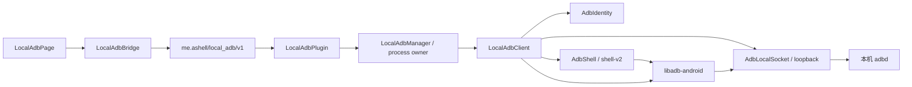

# AShell 本机 ADB / Local ADB

当前核对：2026-10-16，main/4d3c446，文档同步开始时工作区clean。当前配对/连接/独立命令、进程状态推送与有限断链恢复保持既有合同；最新 [T001](../tasks/T-2026-10-16-001-adb-docs-sync.md) / [Baseline21](../BASELINE/21_ADB_RENDER_UI_BASELINE_2026-10-16.md) 补齐App侧绘图与PC展示变化。[13_REMOTE_ADB](13_REMOTE_ADB.md)与[14_ADB_MIRROR](14_ADB_MIRROR.md)分别记录PC控制及媒体/触摸；旧任务为历史快照。

当前实现是 Android App 内的独立无线调试客户端：配对、连接、验证 shell 身份和执行单次命令。主页向左滑到右侧 ADB 页，向右滑返回。采用 `libadb-android:3.1.1`；没有恢复旧 LADB 进程、`libadb.so`、旧通道或无障碍自动配对。T004增加PC远程ADB；2026-10-14 T001新增[独立scrcpy投屏与ADB优先触摸](14_ADB_MIRROR.md)，共用身份、独立媒体/控制连接。仅V0，构建/运行待验证。

证据为源码/V0。当前会话未取得对应 APK、构建日志或真机测试结果，不能据“允许同步文档”推定 V2/V3 已通过。初始实现见 [T003](../tasks/T-2026-10-13-003-local-adb-docs.md) / [ADR-0017](../ADR/0017-isolated-local-adb.md)；后续执行通道与同步由 [ADR-0025](../ADR/0025-adb-lanes-and-state-sync.md)补充。

## 1. 使用方式

1. 使用 Android 11 / API 30 或以上设备，连接 Wi-Fi。Android 10 及以下仍可安装原产品，但本模块的配对和 shell 操作不可用。
2. 在 Android 主页向左滑进入“本机 ADB”，点击“打开开发者选项”，手动开启系统“无线调试”。此按钮仅打开设置，不自动授权或启用调试。
3. 首次配对用系统分屏或小窗同时显示 App 和系统“使用配对码配对设备”窗口。默认“只填配对码”只展示六位码输入框，隐藏两个端口框及扫描按钮。保持系统窗口打开，点击“配对并连接 ADB”，在执行时自动发现端口、配对、连接并验证 Shell。
4. “手动端口”展示配对端口、连接端口、配对码和扫描按钮。配对端口见系统配对码窗口，连接端口见无线调试首页；填写值直接使用，任一端口留空则自动发现。扫描填入本机唯一发现值，未发现的旧值清空；调试开关或系统窗口变化后重新核对。切模式解除焦点，手动值可保留但自动模式不消费隐藏端口。模块只连接本机127.0.0.1，不读取系统六位码，不再支持二维码配对。
5. 连接会先运行 `id -u`，退出码为0且输出恰为2000或0才显示已连接。普通设备预期为 shell 身份；模块不会替设备获取 root。
6. 在 Shell 区直接填写 `id` 等命令，不加 `adb shell` 前缀。界面显示输出和真实退出码；命令非零退出码不等于 ADB 传输失败。
7. 点击“断开”关闭共享连接，系统配对仍保留；新版本PC经状态推送看到disconnected，旧端需手动刷新或重开弹窗。PC ADB 菜单可撤销本 App 身份/记录；系统无线调试的已配对设备列表旧条目仍须手动忘记。

已配对时保持无线调试开启，点击“我已配对，连接并验证 Shell”，无需配对码或打开系统配对码窗口。自动模式发现连接端口，手动模式使用填写的连接端口（留空自动）；不使用配对端口。App 的记录不保证系统授权仍有效，连接时重新验证。无线调试重开、网络变化或设备重启后端口可能变化；ROM 的分屏、设置入口及 loopback 能力须真机确认。

## 2. 源码与隔离边界

| 文件 | 职责 |
|---|---|
| `flutter/lib/mobile/adb/local_adb_page.dart` | 页面、输入校验、输出、生命周期与 3 秒状态轮询 |
| `flutter/lib/mobile/adb/local_adb_bridge.dart` | 类型化 MethodChannel consumer；status/output/exitCode |
| `flutter/android/app/src/main/java/me/ashell/localadb/LocalAdbPlugin.java` | FlutterPlugin + ActivityAware，本机 owner 的 MethodChannel adapter |
| `flutter/android/app/src/main/java/me/ashell/localadb/LocalAdbManager.java` | 共享身份/记录、连接操作串行队列、默认20秒/一键配对35秒watchdog；每秒检查并按变化推送快照，有限恢复 |
| `flutter/android/app/src/main/java/me/ashell/localadb/RemoteAdbNative.java` / `AdbPortDiscovery.java` | 独立远端JNI / 本机NSD配对与连接端口发现，见13_REMOTE_ADB |
| `flutter/android/app/src/main/java/me/ashell/localadb/LocalAdbClient.java` | 配对/连接 owner，运行 `id -u` 验证后才置connected，区分握手与UID验证失败 |
| `flutter/android/app/src/main/java/me/ashell/localadb/AdbLocalSocket.java` | 仅 loopback 的可关闭 socket 转发，让超时/取消中断上游阻塞 I/O |
| `flutter/android/app/src/main/java/me/ashell/localadb/LocalAdbCommands.java` | 独立Shell命令队列，总计8项、最多2并发，各项私有连接/20秒超时及requestId取消 |
| `flutter/android/app/src/main/java/me/ashell/localadb/AdbStreamCompat.java` | 固定libadb3.1.1的OPEN兼容层，锁内等待与UTF-8包长度、有界8秒等待、R8反射成员 |
| `flutter/android/app/src/main/java/me/ashell/localadb/AdbShell.java` | shell-v2 帧、UTF-8 stdin、stdout/stderr、退出码与输出上限 |
| `flutter/android/app/src/main/java/me/ashell/localadb/AdbIdentity.java` | 独立 RSA 身份、证书、AndroidKeyStore 包装加密与进程内缓存 |
| `flutter/android/app/local-adb.gradle`、`local-adb.pro` | 独立依赖声明、仓库范围和 Release keep 规则 |

8662f23 本机实现有三个接入点：`home_page.dart` 在 `isAndroid && !bind.isOutgoingOnly()` 内把 `LocalAdbPage` 放在 `ServerPage` 后；`oFtTiPzsqzBHGigp.configureFlutterEngine()` 去重注册插件；`app/build.gradle` 加载 `local-adb.gradle`。该提交新增9文件、原3文件增加7行；T004 的远程增量另见13_REMOTE_ADB，不能继续用三个钩子描述全部当前实现。

模块不依赖产品 `MainService`、Accessibility、`ServerModel`、MediaProjection、normal/SKL/ignore、side-button 或远程 terminal。远程扩展通过独立 Rust 模块/JNI 和专用 peer 消息/PC UI，不走产品采集 JNI；没有新增后台服务、开机入口或 Manifest 权限。ADB connected 只表示本地 shell 验证后的传输状态，不表示远控在线、屏幕共享或首帧就绪。

“独立本机入口”不等于额外实现了对既有远控触控 UI 的隔离或二次授权；PC ADB 的权限合同见13_REMOTE_ADB。旧实现的历史档案见 [ADB/LADB Integration Memory](../ADB_LADB_INTEGRATION_MEMORY.md)，不得按该档案恢复自动化和旧权限。

## 3. MethodChannel 合同

通道：`me.ashell/local_adb/v1`。除只读状态、设置和取消入口外，操作要求 API 30+；连接管理通道最多1执行+7排队，Shell使用独立2并发/总计8项通道；本机页面根据本窗口忙状态和connectionBusy禁用提交，其他PC可独立执行命令。

| 方法 | 参数 | 成功返回 | 语义 |
|---|---|---|---|
| `status` | 无 | `{supported, apiVersion, mirrorVersion, connected, paired, pairedAt, connectPort, busy, connectionBusy, queued, runningCommands, recovering, operation, phase, revision, instance, discovery}` | 只读共享状态；paired只是记录，不查询系统配对列表 |
| `openSettings` | 无 | null | 打开开发者选项；失败时提示手动打开 |
| `pair` | `port: int`、`code: String` | null | 断开旧连接，使用系统配对码建立信任；配对成功不等于已连接 |
| `connect` | `port: int` | `uid=2000`或`uid=0`验证结果 | 0/省略尝试NSD与上次端口；本机页面默认自动发现，可手工覆盖 |
| `discover` | 无 | pairPort/connectPort/ambiguous | 本机双NSD发现，不断开已连接ADB |
| `pairConnect` | port/code/connectPort | id结果字符串 | 配对后自动连接，端口0自动发现；部分成功保留记录并回报连接错误 |
| `shell` | `command: String` | `{output: String, truncated: bool, exitCode: int?}` | 单次非交互 shell；stdout/stderr 合并，退出码来自协议 |
| `disconnect` | 无 | null | 关闭会话；不忘记系统配对 |
| `cancel` | 无 | null | 取消该Plugin owner的排队/当前操作；不取消其他PC请求 |
| `revoke` | 无 | null | manager支持清本App身份/记录，PC提供确认入口；本机页无此按钮 |

端口范围 1–65535，0/省略表示自动发现；配对码为 6 位数字。业务参数仅接受port/connectPort/code/command/requestId，未知参数（含已移除 serviceName）返回invalid。命令非空、无 NUL，native 长度不超过 4096（Java UTF-16 code units）。错误码包括 `invalid`、`unsupported`、`busy`、`settings`、`unavailable`、`adb_failed`、`cancelled`、`timeout`；异常细节不会直接返回或记录日志。

## 4. 生命周期与协议细节

- `LocalAdbManager`单worker执行discover/pair/pairConnect/connect/disconnect/revoke，Shell转交LocalAdbCommands。默认20秒watchdog、一键配对35秒，独立NSD扫描最多6.5秒。连接在本次预算内最多两次尝试，自动发现先3.5秒、重试1.5秒；无新候选可尝试上次成功端口，歧义则要求手动。仅重试连接/UID探测，不重放配对码或命令。
- `LocalAdbClient.connect`以总期限覆盖TLS和首个Shell OPEN/read，manager每次连接至多7秒且服从剩余总预算，其他私有client默认10秒；底层socket连接3秒、ADB connect等待8秒均受外层期限约束。成功须UID准确且退出码0，并再次核对连接未关闭。默认close等待最多1秒，取消只关闭各自socket，旧定时器不打断下一任务。
- `AdbLocalSocket` 只监听/连接127.0.0.1。任务声明使用transport后，取消可关闭socket并中断worker；纯discover及配对/连接尚处于发现阶段时的失败/取消保留已有连接。最终回调依赖worker退出，watchdog不是已验证的严格返回时限。配对已确认成功而连接失败/超时/取消时，保留记录并提示直接连接。
- `AdbStreamCompat`修复固定libadb3.1.1的OPEN先发包后无条件wait竞态：创建库内stream、先持有monitor再发OPEN，按ready/closed谓词等待，最多8秒；按UTF-8字节数编码destination。反射成员在local-adb.pro保留，不静默回退旧open。1c46e74移除不可访问的package-private AdbProtocol导入，改本地编码标准24字节OPEN头与NUL结尾正文，避免该Android编译错误；需要Release/R8重验。
- `AdbShell`通过该兼容入口打开固定ASCII `shell,v2,raw:sh`，将 UTF-8 命令加换行经 stdin 发送，再发送 CLOSE_STDIN；读取退出帧，避免上游旧 shell EOF 竞态和多字节 OPEN 长度问题。
- 合并输出最多 65536 字节（64 KiB），超限会关闭命令 stream、标记 `truncated=true`，此时 `exitCode` 可为 null，不伪造成功。单次包长度上限 1 MiB；不提供 PTY、交互输入或持续终端会话。每次执行的 `cd`、环境变量不跨命令保留。
- 页面 keep-alive；App 在前台每 3 秒查询状态，返回前台也查询；上一次查询未结束时跳过，执行任务期间仍可查询。只是查询 transport，并非持续执行 `id`。左右切页不会自动断开；后台停止轮询，不自动撤权。PC已取消周期刷新，本机页保持此行为。
- 页面dispose释放timer/controllers并取消自身工作，engine detach取消本机owner；共享连接和worker归Android进程，不因一个页面/PC离开而销毁。连接管理任务使用共享transport后的失败/取消会清该transport；独立Shell命令失败只关闭自己的连接。apiVersion3可按requestId取消，兼容不传时按owner取消。
- manager每秒检查真实transport，变化后推送带instance/revision的快照；不周期执行id、不伪造connected。当前进程成功连接后遇意外断链最多恢复3次，显式断开/撤销不会自动连回；重启App不自动恢复。恢复重新进行UID验证，不重放配对码、命令、画面或黑屏操作。
- 关闭连接/命令 stream 不回滚命令已经造成的系统变化，也不保证终止命令另行派生的后台进程。

## 5. 身份与安全边界

`AdbIdentity` 生成 RSA-2048 私钥与自签名证书，以 AndroidKeyStore AES-GCM 密钥（alias `ashell.localadb.identity.v1`）加密后写入 `noBackupFilesDir/local-adb-identity.v1`。身份在需要 pair/connect 时加载，损坏或包装密钥缺失会报错，不静默替换。RSA 私钥会在进程内解密使用，不能描述为不可导出的硬件 RSA 密钥。

为兼容上游连接关闭时销毁 key、SSLContext 又缓存该 key 的行为，`BorrowedRsaKey` 将身份生命周期保持到 App 进程结束，不能把断开连接称作私钥已清零。配对码提交即清空输入框，不落盘；命令/输出仅保留在页面状态，本模块无持久命令历史、审计日志或内容上传。

本地 Shell 是用户主动输入的任意命令，不带命令白名单或逐条二次批准；系统配对授予的是 ADB 能力。断开与超时不是系统撤权。旧 prefs/私钥/授权不导入也不自动清除；新身份与 T009 的旧资产分开。设备数据重置不是常规故障处理步骤，因为可能同时影响原产品配置。

T004 / ADR-0018增加专用远程协议、远程控制权限gate、共享撤销与owner取消；通用shell没有命令内容白名单/持久审计，完整边界见13_REMOTE_ADB。T001的scrcpy资产推送/启动、socket、视频解码和输入分流另见14_ADB_MIRROR及ADR-0021；不占用原Shell队列。

## 6. 构建与第三方依赖

当前源码固定项如下；完整快照见 [Baseline 11](../BASELINE/11_LOCAL_ADB_BASELINE_2026-10-13.md)，资产见 [External Registry](../../EXTERNAL_ASSET_REGISTRY.md)。

| 坐标 | 来源与版本 | 用途 / 许可来源 |
|---|---|---|
| `com.github.MuntashirAkon:libadb-android:3.1.1` | JitPack；源码注释记录 revision `c849886ebc6d48e7b46d967e78a6bb65c90c3b74` | ADB/TLS/配对；[上游 README](https://github.com/MuntashirAkon/libadb-android/blob/3.1.1/README.md) 提供 GPL-3.0-or-later / Apache-2.0 双许可，本集成选 Apache-2.0 |
| `com.github.MuntashirAkon.spake2-java:spake2-android:2.2.1` | JitPack | SPAKE2；[上游 README](https://github.com/MuntashirAkon/spake2-java/blob/2.2.1/README.md) 标 LGPL-3.0，并说明未经过安全审计 |
| `org.bouncycastle:bcprov-jdk15to18:1.81` | Maven Central | ASN.1 / 证书构造；[Bouncy Castle license](https://www.bouncycastle.org/licence.html)，MIT 风格；不注册全局 provider |
| `org.conscrypt:conscrypt-android:2.5.3` | Maven Central | TLS/native；[上游 LICENSE](https://github.com/google/conscrypt/blob/2.5.3/LICENSE)，Apache-2.0；包含的第三方 notices 需随正式产物核对 |

前两项 `transitive=false`，由独立文件显式列出依赖，避免导入上游较新的 AndroidX/Kotlin 依赖图。`exclusiveContent` 将两个指定 module 限定到 JitPack，将 BC/Conscrypt group 限定到 Maven Central。`local-adb.pro` 保留 Conscrypt 反射和 SPAKE2 JNI 类；Release 构建必须验证 keep 规则及各 ABI native 库。

沿用 compileSdk 34 / minSdk 21 / targetSdk 33、Java 8、AGP 7.3.1、Gradle 7.6.4；本模块没有升级工具链、修改 Rust/Flutter lock 或增加 Gradle 子工程。原 `**/libadb.so` 打包排除仍有效；新 AAR 的 SPAKE2/Conscrypt JNI 库是不同资产，不能一起排除。

本地 Linux 仍从仓库根运行 `./build.sh 1`（arm64）或 `./build.sh 2`（多 ABI）；独立 CI 见 [客户端 Actions](../BUILD_CLIENTS_ACTIONS.md)。首次解析需构建机可访问上述仓库。本模块不需要从旧 LADB 目录拷贝 binary，也不需要为 App 配对预装一个 host adb runner。

固定版本不等于完整可复现供应链。尚待正式构建收集实际 AAR/JAR/SO SHA-256、解析依赖、ABI 清单、LICENSE/NOTICE、SPAKE2 分发材料和签名。本文登记许可事实，不代表完整 SBOM/合规或发布审查已经完成。

## 7. 排查与验收

| 现象 | 检查与下一步 |
|---|---|
| 提示 Android 11+ | API < 30 不支持本模块配对流程；不自动降级到旧 ADB |
| 配对失败 | 保持系统配对窗口可见，重新核对当前配对端口与六位码；先检查分屏/小窗及 ROM 限制 |
| 配对成功但连接失败 | 使用无线调试首页连接端口；确认仍已配对、调试开启、端口未变，不能复用配对端口 |
| 断开后再次连接失败 | 核对端口/系统配对，保留脱敏错误码与复现顺序；可能需要对应 ROM 和 TLS/身份检查 |
| 操作超时/取消 | 连接管理任务先等待清理并检查状态；独立命令取消不应使共享连接、其他命令或画面失效。不自动重试用户命令 |
| 输出被截断 | 已达到 64 KiB，不代表命令成功；缩小查询范围后重新执行，不能从 null exitCode 推定成功 |
| 模块不可用 / native linkage 失败 | 确认 APK 包含新提交、插件注册和对应 ABI 的 SPAKE2/Conscrypt；检查 Release keep 与构建依赖解析 |
| 身份损坏/包装密钥不可用 | 无自动修复；经用户确认可在PC独立ADB菜单撤销本App身份后重配，勿直接清空整个App数据 |

《编译验证需求》：正式 Linux 构建机、仓库根，按需执行 `./build.sh 1` 和 `./build.sh 2`；或经授权运行独立 Android Actions。核对依赖解析、Release/R8、所有目标 ABI JNI、旧 libadb.so 缺席，以及主库完整性。记录 source SHA、环境、APK hash 和结果。

真机验证用 [TEST_MATRIX](../../TEST_MATRIX.md) 的 AND-09—13：正确/错误/过期配对、两端口、`id -u`、Unicode 输出、非零退出码、取消/20 秒超时/64 KiB 限制、重复连接、后台/销毁、系统忘记配对。Android 10 做不支持检查，Android 11/13/14/15 和目标 ROM 做支持矩阵。AND-01/02/04/05/07/08、FLT-04/05/06 验证原远控、采集、输入、语音与生命周期未回归。以上 V2/V3 在本任务均为 NOT_RUN。
