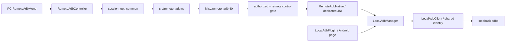

# PC 远程 ADB / Android 共享状态

最后核对：2026-10-13，`main/917e6612cdfd819b824626564478a3ff1d84eec4` 上的 T004 工作树。源码/V0，尚未编译或做多 PC 真机验证。决定：[ADR-0018](../ADR/0018-device-owned-remote-adb.md)；任务：[T004](../tasks/T-2026-10-13-004-remote-adb.md)。

PC 通过现有已认证远控会话向 Android App 提交配对、连接和 shell 请求。ADB 私钥、配对记录和连接都在 Android；PC 不是 ADB host，也不保存 Android 的 ADB 私钥。没有加入 scrcpy、ADB 投屏、视频解码或 ADB 输入注入。原 Accessibility、MediaProjection、normal/SKL/ignore、terminal、ZEGO 和产品身份保持。

## 使用

1. PC 与 Android 都安装包含本次修改的版本，先建立普通远控会话。PC 远控窗口顶栏选择 **ADB → 远程 ADB 连接配对**；打开时先读取 Android 状态，未确认前不允许提交操作。
2. Android 11 / API 30+ 手动开启无线调试，打开“使用配对码配对设备”，保持窗口打开。在 PC 填写窗口中的配对端口和六位码，点击“让 Android 配对”。不需要在 Android App 页面再次输入，也不使用无障碍点击系统设置。
3. 配对成功只建立系统信任。点击 **我已配对，建立连接**，Android 尝试发现本机 `_adb-tls-connect._tcp.` 连接端口，找不到则尝试上次成功端口。失败时手工填写无线调试首页的当前连接端口；它通常不同于配对端口。
4. Android 运行 `id`，退出码 0 且身份为 shell/root 才报告 connected；不会主动获取 root。进入“远程 ADB 命令”输入不带 `adb shell` 前缀的命令。
5. 窗口打开期间每 3 秒读取共享状态，也可手动刷新。关闭窗口停止轮询并取消本 PC 进行中的请求；已空闲的 ADB 连接保留。原远控会话不受模块自动控制。
6. “断开 ADB 连接”关闭所有 PC 共用的 ADB transport，保留身份和记录；“撤销 ADB 配对”经确认后取消共享队列并清本 App 身份/记录。系统配对列表旧条目仍需手动忘记，不能宣称 App 已操作系统配对列表。

`paired` 是 App 成功配对/连接的记录加身份文件存在性检查，不是对系统配对数据库的实时查询。系统忘记配对后记录可能仍在，必须再次连接验证。旧版独立本机 ADB 身份可以继续使用；即使没有新记录，也可点击“我已配对”尝试连接，成功后补记。

## 多 PC 语义

| 场景 | 源码行为 |
|---|---|
| PC A 配对成功但没有 connect；PC B 新连接 | B 查询同一个 Android manager，看到 paired=true / connected=false，可直接 connect |
| A、B、C 同时提交命令 | 一个正在执行、最多七个排队，按 Android 收到顺序串行；不会同时争用同一 ADB stream |
| B 刷新状态 | 读取共享 paired、connected、operation、queued；不读取 A 的命令或输出 |
| A 断线/关闭控制权限 | 取消 A 的排队及执行中请求；空闲共享连接保留。若取消 A 正在使用的 transport，连接会断开，其他 PC 须重新连接 |
| A 撤销配对 | 取消现有排队请求与当前操作，随后清共享身份；其他 PC 下次刷新看到记录/连接消失 |
| Android App 进程重启 | 身份与配对记录仍在，连接和队列丢失；任一已授权 PC 手动重连，无命令自动重放 |

这是共享状态轮询，不是推送到所有 PC 的即时广播。命令结果通过原请求 token 单独返回，既不广播给其他 PC，也不存入持久历史。当前 UI 每个 PC 同时提交一项操作；Android 的全局队列支持其他 PC 加入。取消/关闭 stream 不能回滚命令已经造成的系统变化，也不保证终止其后台子进程。

## 调用链与文件

- PC 独立目录：`flutter/lib/desktop/adb/remote_adb_controller.dart`、`remote_adb_menu.dart`；`remote_toolbar.dart` 只增加入口。仅原生 desktop 普通远控窗口显示，Web/文件/terminal 窗口不提供入口；非 Android 远端回报 unsupported。
- Rust：新增 `src/remote_adb.rs`；`src/lib.rs` 注册。`src/flutter_ffi.rs` 为既有 `session_get_common` 增加三个 key，函数签名和 FRB 生成 ABI 不变。
- Peer：`libs/hbb_common/protos/message.proto` 的 `Misc.oneof` 追加 `remote_adb = 40`；`src/client/io_loop.rs` 仅增加 reply 分发，`src/server/connection.rs` 仅增加请求分发及 ADB 取消钩子。
- Android：`LocalAdbManager.java` 是进程 singleton，接收本机 Plugin 与远端请求；`RemoteAdbNative.java` 是独立 JNI 桥；`AdbPortDiscovery.java` 做有界本机 NSD 查询。原五类见 [本机 ADB](12_LOCAL_ADB.md)。
- 不走产品 `pkg2230`/`ffi` JNI，不接原输入 mask、terminal 或视频协议。没有修改 Manifest、Gradle 依赖坐标、Cargo/Pub lock、构建脚本或 CI。

## 协议 v1

专用 protobuf 字段承载 JSON，不额外加密/封装 payload；**现有 peer 会话的认证、加密和 relay-only 策略继续保持**。Android App 与本机 adbd 仍使用无线调试协议要求的 TLS/SPAKE2，不能通过“明传输”要求关闭它。

请求形状：`{v:1, kind:"request", id, method, port?, code?, command?}`。PC Rust 生成随机 UUID id；UI 不提供该 ID。方法白名单为 `status / pair / connect / shell / disconnect / revoke / cancel`。

| 方法 | 参数 | 结果 |
|---|---|---|
| status | 无 | state，只查询不连接 |
| pair | port 1–65535、code 六位数字字符串 | null；成功记录 paired/pairedAt，仍 disconnected |
| connect | port 0 或省略为自动发现；1–65535 手工端口 | 已验证的 id 输出；记录成功端口与 paired |
| shell | command 非空、无 NUL、最多 4096 Java UTF-16 units | output / exitCode / truncated，stdout/stderr 合并 |
| disconnect | 无 | null，保留配对记录 |
| revoke | 无 | null，清本 App 身份/记录；全局影响，非系统列表管理 |
| cancel | 无 | null，取消该连接 owner 的操作；实际结束由原请求回执报告 |

回执形状：`{v:1,id,ok,state?,result?}` 或 `{v:1,id,ok:false,error,message,state?}`。state 包含 `supported / paired / pairedAt / connected / connectPort / busy / queued / operation / revision`。revision 是当前进程操作计数，不是跨进程永久版本，也不能把它当作系统配对列表版本。Rust 早期拒绝的回执可没有 state。

FFI keys：`remote_adb_request` 返回本地请求 id 或错误；`remote_adb_poll` 读取并消耗回执，空串表示待处理、null 表示不存在；`remote_adb_forget` 清本地等待项，不发送远端命令。每项都绑定 Flutter session UUID，返回时另核对 peer 与请求 id。

输入 JSON 上限 32 KiB，输出 JSON 上限 512 KiB（覆盖 64 KiB 文本 JSON 转义膨胀）；Android 命令输出最多 64 KiB。PC 等待表最多 64 项，Android native 回复表最多 64 项/每连接 10 项，190 秒惰性清理。PC status 8 秒超时，其余 180 秒；不自动重复命令。Android 20 秒 watchdog 触发取消，worker 完全退出后才开始下一项，不能把它表述为所有 ROM 已验证的严格返回期限。

## 生命周期、发现与撤销

manager 在首次 Flutter plugin attach 时创建，只有 application context，无 Activity 全局引用。JNI 保存独立 JavaVM/GlobalRef，调用线程通过 attach 和 local frame 进入 Java，只 post 到主 looper。队列及回执在主 looper 串行管理，阻塞 I/O 在一个 worker；取消关闭 socket、中断 worker并排队清理 reader，不在主线程 join。engine detach 只取消本机 owner，不销毁共享连接或 worker；进程结束由 OS 回收。

NSD 只解析本机 loopback/网络接口地址的服务，最多 5 秒、最多 32 个待解析服务；不连接其他设备广告，实际 ADB 始终连 `127.0.0.1`。旧 mDNS/无障碍自动配对模块没有复活，也不扫描端口或请求新 Manifest 权限。OEM/网络限制可能使发现失败，手工当前连接端口是明确回退。

配对记录保存在 `local_adb_record_v1` SharedPreferences；私钥仍使用 `noBackupFilesDir/local-adb-identity.v1` 与 AndroidKeyStore alias `ashell.localadb.identity.v1`。记录备份不等于密钥迁移；paired 还要求身份文件存在。配对码提交后清输入框，操作结束/取消清队列文本，不落盘或记录日志。

撤销先断开 transport、清记录，再清本 App 内存身份/身份文件/KeyStore wrapping key。固定 libadb 3.1.1 的 [SslUtils 源码](https://github.com/MuntashirAkon/libadb-android/blob/3.1.1/libadb/src/main/java/io/github/muntashirakon/adb/SslUtils.java) 缓存首个身份的静态 `sslContext`，本模块在撤销时反射重置它；`local-adb.pro` 保留此类及 JNI 回调。该兼容点与依赖版本绑定，升级必须复核；任一步失败返回撤销未完整完成，不能虚报成功。

## 威胁模型与兼容边界

- 远程 gate 在 Android Rust `self.authorized` 分支内再次要求 `peer_keyboard_enabled()`，排除 file-transfer、terminal、camera；port-forward 不进入此分支。UI 显示不是权限证明。控制权限关闭与连接 Drop 只向本模块发 owner 取消，不更改原权限处理。
- 本次明确将 ADB 任意 shell 能力授予已有远程控制权限的 PC，没有新增逐命令审批、命令内容白名单或持久审计。这里的 method 白名单不是 shell 命令白名单。这是新增高权限能力的设计边界，已有会话认证问题不会被本模块自动修复。
- 所有 PC 共用一个 App 身份；不能单独撤销 PC B 对此身份的“配对”，因为 B 从未持有 ADB 私钥。限制 B 应由原远控连接/控制权限管理；撤销 ADB 是所有 PC 共享动作。
- payload/代码/输出不记日志、不自动上传；结果只返回发起连接。任意 shell 仍可能按用户命令改变系统、权限或进程，隔离代码不能保证任意命令不影响原产品。
- 新 PC→旧 Android：unknown protobuf 字段被旧实现忽略，status 超时提示版本/连接问题，不能假报成功。旧 PC→新 Android：不发送字段 40，原链路保持。新 PC→非 Android 新端：明确 unsupported。两端都需重编本次 Rust；只替换 Dart/Java 不足以接通。

## 验证需求

当前仅 V0：跨层字符串、字段号、JNI/FRB 签名、权限分支、所有权/有界队列、敏感内容处理、受保护文件 diff 与文档链接检查。未运行 build/test/analyze/codegen、依赖安装、设备操作或工作流。

《编译验证需求》
- 命令：Android Linux 仓库根 `./build.sh 1`、`./build.sh 2`；Windows 正式构建机仓库根 `build.cmd`。也可另行授权独立 `build-clients.yml` 两端编译。
- 环境：项目原定 Rust/Flutter/NDK/Gradle/Windows 工具链；Android API 30+、至少两台 PC，保留可测试的旧端版本。
- 执行目录：各正式机器的 A-Shell-You 仓库根。
- 目标：normal protobuf build 自动生成字段 40；FRB tracked 文件无需 codegen；Android Release/R8 保留 JNI 回调和 SSLContext reset，所有目标 ABI 可加载；PC 顶栏显示、跨端配对/连接/命令/取消/撤销真实通过。

[TEST_MATRIX](../../TEST_MATRIX.md) 的 ADB-R01—07 全部 NOT_RUN：尤其验证 A 配对未连接→B 连接、并发/队列满、请求隔离、权限关闭/断线取消、系统忘记、撤销后重配、NSD 外设备广告与手工回退、旧端超时。原 AND-01/02/04/05/07/08、FLT-04/05/06 以及本机 AND-09—13 必须保留回归。
