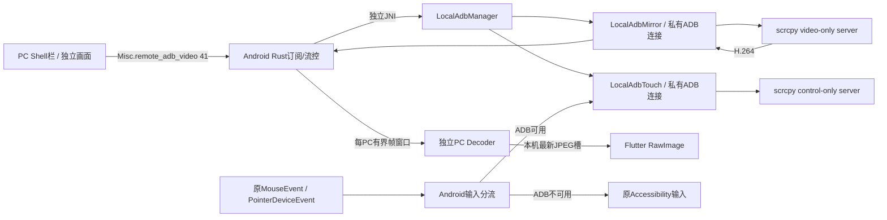

# AShell ADB 投屏与触摸优先级

2026-10-14，T-2026-10-14-001，main/a1486ee上的未提交实现；V0，**未编译、未真机验证**。见[任务](../tasks/T-2026-10-14-001-adb-mirror.md)、[ADR-0021](../ADR/0021-independent-scrcpy-mirror.md)、[Baseline16](../BASELINE/16_ADB_MIRROR_BASELINE_2026-10-14.md)。此前文档“无ADB投屏”是T008及之前的历史结论。

## 使用与边界

两端更新后，先无线调试配对、连接并验证Shell。PC Shell栏保留返回/主页/多任务，追加“开投屏”“关投屏”。开投屏显示独立、可拖动/放大的ADB画面窗口；黑边不接受触摸，画面支持点击、按住、拖动。任意有控制权限的普通PC可关闭设备的共享投屏，所有PC同步关闭。单PC离开只取消自己的订阅，最后一个订阅离开释放视频资源；重连不会自动重新开启已停止的视频。

**ADB已连接并验证Shell时，触摸优先使用ADB；否则回到已有无障碍触摸。** 不要求开启ADB视频：原屏幕共享与无障碍截图也使用同一Android输入选择器。接管时只结束无障碍的远程手势、清理延迟点击/滚轮队列，不关闭无障碍Service、权限或截图。关闭ADB投屏保留ADB触摸；断开/撤销ADB同时释放新模块的控制连接与手势。无障碍不存在且ADB不可用时，没有可用触摸路径。

完整键盘/文字输入并未迁移到ADB；Shell栏三键仍经字段40执行固定shell keyevent。新实现不改MediaProjection、normal/SKL/ignore采集、原VideoFrame解码/texture/waiting、产品身份、声音、terminal或relay/加密策略。

## 链路与所有权

- `LocalAdbManager`继续拥有原身份/配对/串行Shell队列。投屏和触摸各用单独`LocalAdbClient`、连接、线程，不占长期Shell队列。
- `LocalAdbMirror`启动一份video-only服务：H.264、max_size=1280、max_fps=20、2Mbps、目标关键帧间隔1秒；无audio/control/power_on。20秒启动/无帧超时仅停止自身。
- `LocalAdbTouch`在Shell验证后准备control-only服务：video=false、audio=false、clipboard_autosync=false、power_on=false。不需要MediaProjection。15秒启动、5秒写入超时；异常时显示控制通道错误，ADB仍可用期间不偷偷向无障碍重复注入。
- 普通画面沿用既有坐标和`SCREEN_INFO.scale`；ADB窗口传图像相对坐标，由独立几何适配器换算到真实屏幕。旋转不匹配时释放当前手势。
- 触摸队列64项，合并相邻MOVE；溢出释放手势。每次拖动仅一个PC持有手势，10秒无事件自动抬起，其他PC不能松开该手势。退出/只读撤销释放对应owner。此为并发争用策略，并非跨PC同时多指注入。
- ADB窗口的DOWN/MOVE/UP按序通过异步本机桥，避免桥接线程并行使按下/抬起乱序；切换peer/销毁后丢弃旧epoch输入。

## 视频协议与背压

官方[5.0.1 Streamer](https://github.com/Genymobile/scrcpy/blob/v5.0.1/server/src/main/java/com/genymobile/scrcpy/device/Streamer.java)使用4字节codec-id、12字节session/frame元数据。最高位标识session，其后config/key位分别62/61；不能按旧scrcpy协议解析。Android有界读取，校验H264、尺寸与2MiB帧、64KiB配置；codec配置随关键帧发送。

`Misc.remote_adb_video=41`新增消息含token/action/sequence/generation/尺寸/keyframe/data/state/error/supported与ADB触摸优先级字段；旧40和VideoFrame编号不变。动作watch/unwatch/start/stop/ack/nack/touch/state/frame。touch固定20字节有界整数，在已认证普通会话且非view-only下处理。客户端不能提供server路径、启动参数或shell文本。

最多32订阅者，每PC最多4帧在途，ACK按实际sequence归还额度。慢PC丢帧后等待关键帧，不堆积编码视频；其他PC独立继续。客户端解码队列8项，最新显示槽只有一帧；停止/generation变化清除旧图。旧页面owner不能取消新页面订阅。慢链路仍与原链共用网络带宽，队列有界不意味着物理带宽隔离。

PC使用现有`hwcodec` RAM解码器的独立实例。跨FRB本地桥暂用JPEG+base64，Flutter直接解码到`ui.Image`并释放上一帧，绕过普通ImageCache。50ms读取的是**本机帧/状态槽**，不恢复已移除的远程3秒status轮询。停止后空闲解码线程在250ms接收超时检查中释放decoder/RGB缓存，订阅保留以便再次开启。Android触摸优先级变化推送会推进Shell栏状态epoch，阻止之前在途的查询回执覆盖新状态。没有改FRB签名或手工修改生成文件。此适配有额外本机编码/解码CPU成本，后续可在独立接口内优化texture；目前不宣称达到scrcpy原桌面性能。

## 外部资产与构建

固定官方[scrcpy v5.0.1](https://github.com/Genymobile/scrcpy/releases/tag/v5.0.1)，733930字节，SHA256 `764eb6f79811d5211fe9df341120882ba9994c7a61b897d7bf3fb662e53bc536`，Apache-2.0。APK资产目录`flutter/android/app/src/main/assets/adb-mirror/`同时含LICENSE/NOTICE；文件哈希已与官方发布元数据比对，运行前再次校验。没有验证发布签名或重建上游二进制。

推送到两个模块专用固定临时路径，避免反复失败积累随机文件；scrcpy cleanup及shell EXIT trap清理成功启动的文件。中途取消上传可能留下固定临时文件，下次覆盖。正常视频/控制资源各自关闭，不使用killall、不关闭adbd、不关闭原屏幕共享。

Android沿用Java8/minSDK21，但此无线ADB功能仍需Android11+；不升级Gradle/NDK/Kotlin。Windows正式入口与CI已有`--hwcodec --flutter --vram`；现有image crate提供本地JPEG，无新增Cargo依赖。官方server单独打包，未恢复旧libadb.so或PC adb.exe。

## 待验证

TEST_MATRIX的ADB-M01—M08均NOT_RUN：Android ARM64/universal和Windows编译、两个真实PC同时使用、慢PC、旋转、断线/撤销/只读、三种触摸优先级组合、原共享/无视截图回归。ADB shell验证和控制socket建立不证明所有ROM允许InputManager注入；部分厂商额外调试授权及编码器并发限制需真机确认。不同PC可在下一关键帧加入，不能承诺帧级严格同时显示。

《编译验证需求》：Android正式Linux构建机仓库根`./build.sh 1`；Windows正式环境`C:\Code\A-Shell-You`执行`build.cmd`。随后Android11+与两PC执行上述矩阵。用户后续已明确授权查漏补缺后提交、推送main并触发一次Build AShell clients（both/aarch64），不监控；实际提交/dispatch接受回执见Git与会话交付，不能据此认定编译成功。未执行本地build/test/analyze/codegen或真机验证。
