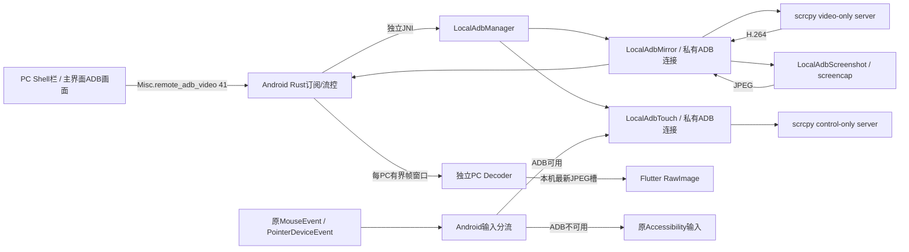

# AShell ADB 投屏与触摸优先级

2026-10-14 T003当前增量：main/941b215初始clean；布局向中线靠拢、状态悬浮移到全主界面右上、ADB控件/私有连接恢复、独立黑色遮罩。见[本轮任务](../tasks/T-2026-10-14-003-adb-controls-and-overlay.md)、[ADR-0023](../ADR/0023-adb-private-overlay.md)、[Baseline18](../BASELINE/18_ADB_OVERLAY_BASELINE_2026-10-14.md)。本轮V0未提交/未编译/未真机验证。前轮941b215已推送并dispatch获204，未监控。下段T002为当时快照。

## 黑色遮罩与控件恢复（T003）

Shell栏新增“开黑屏 / 关黑屏”。Android已验证ADB Shell后，独立`LocalAdbPrivacy`通过私有ADB连接运行APK内`AdbPrivacyOverlay.main`，创建手机上层不透明黑色color layer。**不关闭物理显示、不修改亮度、不依赖或复用无障碍黑屏**。Android11采用`WINDOW_TYPE_DONT_SCREENSHOT`创建元数据，12+采用`setSkipScreenshot`；按AOSP语义从截图、屏幕录制和镜像排除这层遮罩，底层真实内容仍由原来的各采集源接收。接口缺失则报错退出，不用普通遮罩/FLAG_SECURE兜底。平台依据及ROM限制见ADR0023；源码实现不能代替真机可用性结论，受保护内容仍受系统限制。

新增协议41字段privacy_supported(17)、privacy_state(18)、privacy_error(19)，动作black_on/black_off；普通已认证且有控制权限的会话方可操作。状态由Android推送，多PC共用一个遮罩，任一控制PC可关闭。遮罩与视频/截图模式独立；最后一个订阅离开、ADB断开/撤销/重新连接时清理。helper的本机stdin租约10秒无心跳就退出，进程死亡释放图层；应用异常退出也有清理途径。PC没有新增远程定时status查询。退出确认或租约过期前保持stopping，避免失败立即被当作已关闭。

静态发现并修补：原私有连接close无限join可能留在stopping；PC原canStop又排除了stopping和在途请求。现有私有连接有界close、停止3秒守卫、Run隔离、停止期间允许再次关闭；PC桥接5秒超时与独立操作超时，旧epoch不覆盖新会话，导航命令的request/poll/forget也有本机桥超时。拒绝/重复操作返回状态，采集新generation清旧在途帧额度。未在本机复现用户故障，以上是源码可确认的失效路径修复。

PC单源仍居中；双源时普通图右对齐、ADB图左对齐，中间仅1逻辑像素分界。同步修正ADB命中区域/触摸换算和普通画布/滚动条偏移。状态悬浮从普通子画布移到主界面的右上。原Android MainService/Accessibility/采集JNI/输入分流未改动。

2026-10-14，T-2026-10-14-002，main/a0e46b1上的未提交扩展；V0，**未编译、未真机验证**。见[本轮任务](../tasks/T-2026-10-14-002-adb-inline-and-screenshot.md)、[ADR-0022](../ADR/0022-inline-adb-screenshot.md)、[Baseline17](../BASELINE/17_ADB_INLINE_SCREENSHOT_BASELINE_2026-10-14.md)。前轮独立投屏/触摸由a0e46b1提交推送，Build AShell clients both/aarch64获HTTP204且未监控；接受请求不表示编译通过。本轮没有新的Git/CI动作。

## 使用与边界

两端更新后，先无线调试配对、连接并验证Shell。PC Shell栏保留返回/主页/多任务，提供“开投屏 / 关投屏”“开截图 / 关截图”，沿用无障碍栏的蓝色开启、红色关闭按钮样式。ADB画面已并入主界面：单路画面居中；普通画面与ADB都存在时，左普通、右ADB，中间竖分界线；关闭一侧后另一侧恢复全宽居中。原来的ADB浮动窗口外壳与放大按钮已移除，Shell栏仍可拖动、独立隐藏。

“开截图”使用ADB连续系统截图，替换当前ADB视频；“开投屏”可切回scrcpy视频。两模式共用右侧ADB画面位置，均可与普通共享/无视/穿透画面共同接收。黑边不接受触摸，画面支持点击、按住、拖动。任意有控制权限的普通PC可关闭设备当前ADB画面，其他PC同步关闭。单PC离开只取消自己的订阅，最后一个订阅离开释放采集资源；重连不会自动重新开启已停止的画面。

强制截图表示主动、持续通过ADB的系统`screencap`取图，不依赖无障碍权限、MediaProjection或视频编码器；**不能绕过Android的受保护内容/FLAG_SECURE限制**。最长边1280、JPEG质量82、最多2fps，更适合静态画面和视频编码器不可用时；不是高帧率视频模式。

**ADB已连接并验证Shell时，触摸优先使用ADB；否则回到已有无障碍触摸。** 不要求开启ADB视频：原屏幕共享与无障碍截图也使用同一Android输入选择器。接管时只结束无障碍的远程手势、清理延迟点击/滚轮队列，不关闭无障碍Service、权限或截图。关闭ADB投屏保留ADB触摸；断开/撤销ADB同时释放新模块的控制连接与手势。无障碍不存在且ADB不可用时，没有可用触摸路径。

完整键盘/文字输入并未迁移到ADB；Shell栏三键仍经字段40执行固定shell keyevent。本轮仅适配PC展示层的分栏视口和等待提示：原采集/VideoFrame解码/texture/首帧状态不变。ADB有真实帧后仅关闭当前会话waiting-for-image提示，保留配对等弹窗承载层，不用ADB帧伪造普通画面首帧。产品身份、声音、terminal和relay/加密策略保持。

## 链路与所有权

- `LocalAdbManager`继续拥有原身份/配对/串行Shell队列。投屏和触摸各用单独`LocalAdbClient`、连接、线程，不占长期Shell队列。
- `LocalAdbMirror`启动一份video-only服务：H.264、max_size=1280、max_fps=20、2Mbps、目标关键帧间隔1秒；无audio/control/power_on。20秒启动/无帧超时仅停止自身。
- 截图模式复用其私有ADB连接，通过shell-v2执行固定`screencap -p`。单张PNG上限16MiB、stderr上限64KiB、显式退出码必须为0；先检查尺寸（每边<=8192、总像素<=32Mi）再降采样/缩放/编码，JPEG上限2MiB，Bitmap始终释放，无截图落盘。20秒无帧保护会取消私有连接；OOM结束本轮采集。切换模式先停止旧Run，待其finally清理后开启下一generation；显式停止会取消待切换请求。
- `LocalAdbTouch`在Shell验证后准备control-only服务：video=false、audio=false、clipboard_autosync=false、power_on=false。不需要MediaProjection。15秒启动、5秒写入超时；异常时显示控制通道错误，ADB仍可用期间不偷偷向无障碍重复注入。
- `RemoteDisplayLayout`保留普通画布左上原点，仅以可选`CanvasModel`桌面视口宽度控制缩放/居中；点击沿用既有坐标和`SCREEN_INFO.scale`。ADB区域使用本地坐标，由独立几何适配器换算到真实屏幕。旋转不匹配时释放当前手势。普通源按真实video/screenshot状态收起，未知/陈旧状态保留此前画面以兼容重连；两路组件保持挂载、各自接收。
- 触摸队列64项，合并相邻MOVE；溢出释放手势。每次拖动仅一个PC持有手势，10秒无事件自动抬起，其他PC不能松开该手势。退出/只读撤销释放对应owner。此为并发争用策略，并非跨PC同时多指注入。
- ADB区域的DOWN/MOVE/UP按序通过异步本机桥，避免桥接线程并行使按下/抬起乱序；切换peer/销毁后丢弃旧epoch输入。分栏只监听画面有无变化，不由每帧刷新整个主界面。

## 视频协议与背压

官方[5.0.1 Streamer](https://github.com/Genymobile/scrcpy/blob/v5.0.1/server/src/main/java/com/genymobile/scrcpy/device/Streamer.java)使用4字节codec-id、12字节session/frame元数据。最高位标识session，其后config/key位分别62/61；不能按旧scrcpy协议解析。Android有界读取，校验H264、尺寸与2MiB帧、64KiB配置；codec配置随关键帧发送。

`Misc.remote_adb_video=41`含token/action/sequence/generation/尺寸/keyframe/data/state/error/supported与ADB触摸优先级字段；旧40和VideoFrame编号不变。本轮追加format(15，h264/jpeg)和screenshot_supported(16)能力协商，旧空format按H.264兼容；动作增加screenshot，其他watch/unwatch/start/stop/ack/nack/touch/state/frame保持。start/screenshot/stop/touch必须为已认证普通控制会话，touch固定20字节有界整数。客户端不能提供server路径、启动参数或shell文本。

JPEG仅发送给声明支持的PC，旧PC得到更新提示，不送入旧H.264解码器；新PC连接旧Android仍可用H.264，截图按钮不可用。PC先验证JPEG头部尺寸与包尺寸一致（<=1280），再经既有本机JPEG槽给Flutter解码；不再做一遍H.264解码/转码。每张JPEG都是可独立恢复的关键帧，继续使用同一ACK/有界窗口。模式/generation变化清旧图与解码缓存，失败只停止ADB源。

最多32订阅者，每PC最多4帧在途，ACK按实际sequence归还额度。慢PC丢帧后等待关键帧，不堆积编码视频；其他PC独立继续。客户端解码队列8项，最新显示槽只有一帧；停止/generation变化清除旧图。旧页面owner不能取消新页面订阅。慢链路仍与原链共用网络带宽，队列有界不意味着物理带宽隔离。

PC使用现有`hwcodec` RAM解码器的独立实例。跨FRB本地桥暂用JPEG+base64，Flutter直接解码到`ui.Image`并释放上一帧，绕过普通ImageCache。50ms读取的是**本机帧/状态槽**，不恢复已移除的远程3秒status轮询。停止后空闲解码线程在250ms接收超时检查中释放decoder/RGB缓存，订阅保留以便再次开启。Android触摸优先级变化推送会推进Shell栏状态epoch，阻止之前在途的查询回执覆盖新状态。没有改FRB签名或手工修改生成文件。此适配有额外本机编码/解码CPU成本，后续可在独立接口内优化texture；目前不宣称达到scrcpy原桌面性能。

## 外部资产与构建

固定官方[scrcpy v5.0.1](https://github.com/Genymobile/scrcpy/releases/tag/v5.0.1)，733930字节，SHA256 `764eb6f79811d5211fe9df341120882ba9994c7a61b897d7bf3fb662e53bc536`，Apache-2.0。APK资产目录`flutter/android/app/src/main/assets/adb-mirror/`同时含LICENSE/NOTICE；文件哈希已与官方发布元数据比对，运行前再次校验。没有验证发布签名或重建上游二进制。

推送到两个模块专用固定路径。T003将视频jar保留为一份约734KB的模块缓存、下次校验资产后覆盖，避免旧进程EXIT trap误删刚重启的视频jar；不会积累每次运行的随机文件。触摸模块仍使用原EXIT trap，未改动；中途取消上传的固定文件下次覆盖。视频/控制资源各自关闭，不使用killall、不关闭adbd、不关闭原屏幕共享。遮罩直接运行已安装APK，不再上传二进制。

Android沿用Java8/minSDK21，但此无线ADB功能仍需Android11+；不升级Gradle/NDK/Kotlin。Windows正式入口与CI已有`--hwcodec --flutter --vram`；现有image crate提供本地JPEG，无新增Cargo依赖。官方server单独打包，未恢复旧libadb.so或PC adb.exe。

## 待验证

TEST_MATRIX的ADB-M01—M12均NOT_RUN：原有ARM64/universal和Windows构建、多PC/背压、旋转/重连、触摸优先级与原链回归，加上分栏中心/点击坐标、只有ADB时菜单弹窗、跨PC切模式/停止、截图异常及新旧版本矩阵。ADB shell验证和控制socket建立不证明所有ROM允许InputManager注入；部分厂商额外调试授权及编码器并发限制需真机确认。不同PC可在下一关键帧/截图加入，不能承诺帧级严格同时显示。

T003追加ADB-M13—M16，全部NOT_RUN：全宽状态悬浮/窄间隔/原比例滚动坐标、反复开关/取消/卡住清理、多PC遮罩与所有采集源/旋转/隐藏API不支持、新协议与R8构建/旧版本/只读/断链恢复。原无障碍黑屏若由用户单独开启仍按其原逻辑工作，新增排除标记只属于ADB遮罩，不能自动排除其他遮罩。

《编译验证需求》：Android正式Linux构建机仓库根`./build.sh 1`；Windows正式环境`C:\Code\A-Shell-You`执行`build.cmd`。目标为新协议字段自动生成、Java JNI参数一致、Flutter分栏与JPEG接收可编译；随后Android11+与两PC执行上述矩阵。本轮未执行本地build/test/analyze/codegen、真机或CI，不能宣称编译/运行通过。
