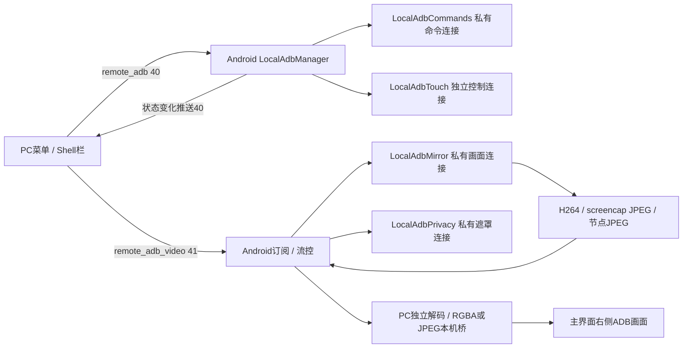

# AShell ADB 投屏、无视、穿透、黑屏与触摸

当前源码核对：2026-10-14，main/`7607349`，初始工作区 clean。本文是当前合同，替换早期“独立窗口、固定2fps、PC视频转JPEG、所有模式统一stop”的描述；历史过程保留在 T001—T004、ADR-0021—0024 和旧基线。最新 [T005](../tasks/T-2026-10-14-005-adb-docs-sync.md)、[Baseline20](../BASELINE/20_ADB_CURRENT_BASELINE_2026-10-14.md)、[ADR-0025](../ADR/0025-adb-lanes-and-state-sync.md) 汇总后续实现。源码复核为 V0，未取得当前版本构建通过或真机验收证据。

## 使用与界面

先通过 [本机 ADB](12_LOCAL_ADB.md) 或 [PC 远程 ADB](13_REMOTE_ADB.md) 配对、连接并验证 Shell。PC 顶栏“移动端操作”左侧的 ADB 开关控制“Shell栏”；ADB 从不可用变为可用时自动显示，持续可用时保留手动收起。侧栏独立拖动、缩放，按钮执行不会主动关闭侧栏。

| Shell栏入口 | 当前行为 |
|---|---|
| 返回 / 主页 / 多任务 | 独立 Shell 命令 `input keyevent 4/3/187` |
| 开投屏 / 关投屏 | 开启或关闭 scrcpy H.264 视频 |
| 开无视 / 关无视 | 开启或关闭连续系统截图；启动提示为“正在启动无视…” |
| 开穿透 / 关穿透 | 开启或关闭 Shell UiAutomation 节点边框、文字绘制 |
| 开黑屏 / 关黑屏 | 独立手机黑色遮罩，与当前 ADB 画面模式分别控制 |
| 网址栏 / 搜索 | 校验 HTTP/HTTPS URL，经独立 Shell 的 `am start` 打开手机浏览器；参数按单个 shell 参数引用 |
| 底部收起按钮 | 仅隐藏当前 PC 的 Shell栏，不停止设备功能 |

侧栏采用原无障碍栏的宽度 `70×scale`、高度 `45×12×scale`、缩放规则、背景/圆角、导航图标、按钮内距/阴影/分隔线及网址栏样式；小窗口允许滚动。无障碍栏的“开防触 / 关防触”仅移除按钮，其原实现保留；ADB 栏没有这两个按钮。

ADB 画面在主界面内显示：单源居中；双源左侧普通共享/无障碍画面、右侧 ADB，中间 1 逻辑像素竖线，两图向中线靠拢。一侧关闭后另一侧恢复居中。状态浮层位于整个主界面右上方。画面底部不常驻“ADB投屏 / ADB连续截图”标签，仍显示真实错误。只有 ADB 画面时，菜单、配对弹窗和 ADB 输入仍可使用。

## 采集模式与原链隔离

三种 ADB 画面模式 `h264 / jpeg / layout` 在设备上互斥；它们与普通 MediaProjection、无障碍无视/穿透分别采集和接收。切换 ADB 模式会先清理旧 Run，再启动最后一个待启动模式。任一有控制权限的 PC 可切换或关闭共享的 ADB 模式，所有订阅 PC 同步状态和画面；不能承诺帧级严格同步。

状态中的 `mirrorVersion=2` 表示支持 `stop_video / stop_screenshot / stop_layout`：关闭按钮只针对对应当前或待启动模式，迟到的“关投屏”不会关闭已切换的无视/穿透。旧端使用兼容 `stop`，需两端更新才能获得完整模式隔离。视频动作、黑屏动作、触摸分别使用序号，旧调用不覆盖新操作；这些序号不替代服务端权限校验。

`LocalAdbMirror`、`LocalAdbPrivacy`、`LocalAdbTouch` 和 `LocalAdbCommands` 各自管理连接和执行资源。关闭 ADB 画面只停止相应私有连接，不关闭共享 Shell、ADB 触摸或普通采集；关闭黑屏也不停止画面。ADB 关闭路径不调用普通 `sessionRefreshVideo`，避免普通编码器与解码器状态被连带重置。普通源与 ADB 源各自保持接收组件，ADB 帧不进入原 `VideoFrame/VIDEO_RAW`。

单 PC 离开仅解除自己的订阅；最后订阅离开停止 ADB 画面和遮罩，共享 Shell/触摸生命周期仍由 Android manager 管理。ADB 断开、撤销或实际更换连接时释放所属视频、遮罩、触摸和命令资源。后台连接恢复不会自动重新开启已停止的画面或黑屏。

## 画质、尺寸与流畅度

`AdbCaptureProfile` 参考原采集当前宽度整数除以350的缩放规则，下限1；最长边再限制为1280。例如1080×2400映射为360×800。H.264编码尺寸需8像素对齐，显示与点击使用额外传输的真实 `source_width/source_height`，不把编码对齐尺寸当作手机物理比例。旋转时重新匹配几何并释放旧手势。

| 模式 | 源与压缩 | 当前限制 |
|---|---|---|
| 投屏 | 官方 scrcpy-server 5.0.1，H.264，video-only，无音频/控制；请求1秒关键帧间隔 | 只读普通画面 QoS 画质/FPS；FPS上限30、码率200kbps—1Mbps；设备编码器决定实际效果 |
| 无视 | 固定 `screencap -p`，有界PNG解码后缩放并编码JPEG | 参考同一画质档位，JPEG低/均衡/最佳60/75/85，自定义50—90；节奏按FPS和JPEG字节预算调整，上限8fps，主动等待最长2秒 |
| 穿透 | 独立 UiAutomation 读取节点并绘制JPEG | 500ms目标间隔（上限约2fps），节点读取耗时可能降低实际帧率；启动时读取JPEG画质 |

视频与 JPEG 编码机制不同，不能说压缩质量或带宽完全一致。截图8fps是节奏上限，不是性能保证；截图仍有系统取图、PNG解码、JPEG压缩开销。相同截图/节点图去重，静态内容约每秒补一张供新PC加入。网络仍与普通画面共享会话及实际带宽，模块隔离不等于网络带宽隔离。

PC H.264 使用独立解码器，输出 RGBA，经 base64 本机桥直接交给 Flutter `decodeImageFromPixels`，已移除中间JPEG重编码；网络仍传 H.264。截图/节点JPEG直接经本机桥交给Flutter，不重复视频解码。最新显示槽只保存一帧，替换时释放旧 `ui.Image`；streaming时本机取帧间隔16ms、空闲100ms，串行读取且不堆叠，不是远程status定时请求。仍有RGBA复制/base64成本，尚未接入专用texture管线。

## 节点穿透

`LocalAdbLayout` 在独立 ADB 连接上运行 APK 内 `AdbLayoutCapture.main`。helper 建立 shell 的系统 context 和回调线程，兼容 UiAutomation 构造入口，以 `FLAG_DONT_SUPPRESS_ACCESSIBILITY_SERVICES` 连接，避免抑制原无障碍服务。读取默认显示的交互窗口，必要时回退到活动或焦点节点；不再只绘制标记 visible 的节点。

每帧最多4096节点、64层，绘制边框和可获取的文字，密码文字遮盖；无节点时显示“当前界面未提供布局节点”。节点及图像仅驻内存，不执行落盘 dump。系统不给出的节点、游戏/视频像素和受保护内容不能凭空重建；已有其他UiAutomation占用、隐藏API或ROM限制会返回分阶段失败信息，不伪造画面就绪。

helper 使用10秒stdin租约，正常关闭和断流会退出并解除自己的UiAutomation；不调用原AccessibilityService。实际并存与清理效果需目标ROM真机确认。

## 黑色遮罩与白字

`LocalAdbPrivacy` 通过自己的 ADB 连接运行 `AdbPrivacyOverlay.main`，创建不透明黑色 SurfaceControl color layer，手机保持物理亮屏。不修改系统亮度，不使用原无障碍黑屏，不设置 `FLAG_SECURE`。

`7607349` 增加白色子图层，内容为：

```text
正在对接服务中心
请勿触碰手机屏幕
避免影响业务
```

文字参考无障碍黑屏的16.5sp、默认字体、左下方约80dp位置，现有stdin心跳用于旋转后的纵向位置更新。黑层与文字层均使用截图排除设置：Android11采用 `WINDOW_TYPE_DONT_SCREENSHOT` 元数据，Android12+采用 `setSkipScreenshot`；12+同时标记自身 `setTrustedOverlay(true)`，没有输入窗口或触摸拦截通道。目标是手机看到遮罩/文字，PC继续看到底层真实画面；该目标需OEM真机验证，不能据静态标记保证所有ROM一致。

隐藏API缺失时真实失败并清理，不降级为会遮住采集的普通覆盖窗。停止等待helper退出确认或本机10秒租约到期，旧Run不能回写新状态；快速关后开保留待开启意图，后续关会清掉该意图。图层、Surface、私有连接随各自生命周期释放。仅排除ADB自己的图层，用户另行开启的无障碍黑屏仍按原逻辑运行。

## ADB触摸

共享连接必须先经 `id -u` 验证UID2000或0，之后 `LocalAdbTouch` 独立启动 scrcpy control-only 服务（video=false、audio=false、clipboard_autosync=false、power_on=false）。由进程manager准备和维护，不要求普通共享或ADB投屏曾经开启。

ADB Shell可用时触摸优先走ADB；接管只结束旧无障碍远程手势，不关闭无障碍服务、权限或采集。ADB不可用且具备无障碍时才回到原触摸。输入服务尚在恢复但Shell仍可用时不会重复向两条链注入；`connected`、`adbPriority`、`touchReady`分别表达Shell、优先级及控制通道状态，仍不能证明所有ROM允许注入。

ADB画面DOWN/MOVE/UP经独立几何换算；原画面指针走原入口的ADB优先分流。PC队列32项、Android队列64项，合并相邻MOVE并保留DOWN/UP顺序；溢出释放手势。多PC可同时连接，但同一次拖动仅一个owner；其他PC的迟到/过期事件不能抬起当前owner的手势。10秒无事件自动抬起，断线/只读释放对应owner。旋转几何不匹配、旧epoch和迟到本机sequence会丢弃旧输入。

触摸启动15秒、写入5秒守卫，有界停止与1—5秒退避重建；重复stop不延长首次清理期限，旧writer不取走新Run队列。完整键盘、文本/中文输入、剪贴板和ADB视图多指输入尚未实现，不能把任意Shell命令接口描述为完整桌面ADB客户端。

## 协议、所有权与资源



- `Misc.remote_adb=40`：配对/连接/命令/回执及共享状态；`Misc.remote_adb_video=41`：订阅、帧、触摸、模式与黑屏控制。原VideoFrame和其他字段编号不变。
- 41字段15/16为格式与截图能力，17—19为黑屏能力/状态/错误，20为节点能力，21/22为真实几何。旧端空format按H.264解释，不把JPEG送入旧H.264解码器；不支持的模式提示更新。
- 普通已认证会话可订阅；只有可控会话可触摸、开关画面和黑屏，文件/terminal/camera会话排除。ADB不依赖手机Accessibility键盘权限；不新增公网明文监听或关闭原会话传输策略。
- Android最多32订阅者，每PC最多8帧且合计8MiB在途；ACK按sequence释放，慢PC等待关键帧恢复，不阻塞其他PC。PC解码队列8项，generation变化清旧缓存；同一generation的重复starting状态保留已收到的H.264配置。
- H.264帧正文上限2MiB，codec配置上限64KiB，合并后的协议帧上限2MiB+64KiB；源边长<=16384、编码边长<=1280。系统PNG上限16MiB，解码前校验每边<=8192、总像素<=32Mi；JPEG上限2MiB、错误文本/节点解析均有界。
- 私有连接有界close，画面20秒启动/无帧守卫、停止3秒守卫。Run、generation、订阅token和PCepoch隔离迟到结果；退出解码时释放资源，不执行killall或关闭adbd。守卫数值不等于所有平台上已验证的硬实时保证。

## 构建、资产与验证

固定官方 scrcpy-server v5.0.1，733930字节，SHA256 `764eb6f79811d5211fe9df341120882ba9994c7a61b897d7bf3fb662e53bc536`，资产及LICENSE/NOTICE在 `flutter/android/app/src/main/assets/adb-mirror/`。沿用此前已登记的官方发布哈希比对记录，本轮未重新下载或验证上游签名/可复现重建；见 [外部资产](../../EXTERNAL_ASSET_REGISTRY.md)。视频和触摸使用各自固定缓存jar，旧进程不通过EXIT trap删除新服务资产；helper直接运行已安装APK。

沿用libadb3.1.1、Java8、Android11+无线调试；未升级工具链或增加PC adb.exe/旧libadb.so。`AdbStreamCompat`用于修复固定依赖的早到OKAY等待竞态。此前直接导入package-private的AdbProtocol导致Android编译错误，`1c46e74`已改为本地编码标准OPEN包，并保留所需反射成员的R8规则；修复后的构建结果仍待验证。

[TEST_MATRIX](../../TEST_MATRIX.md) ADB-M01—M25、ADB-R01—R22及AND-09—13记录当前验收，除明确退役用例外均未取得通过证据。重点覆盖不启动普通共享时ADB触摸、双源独立关停、连点切换、双PC命令取消/争用、配对后连接验证、白字黑屏排除采集与触摸、节点读取及Release反射兼容。

《编译验证需求》：后续经授权在正式Linux仓库根执行 `./build.sh 1` / `./build.sh 2`，Windows正式环境执行 `build.cmd`；验证JNI/R8/协议生成及两端安装包，再做Android11+与至少两PC实测。本次只同步文档并提交推送，不执行构建编排、监控或本地产品验证。
